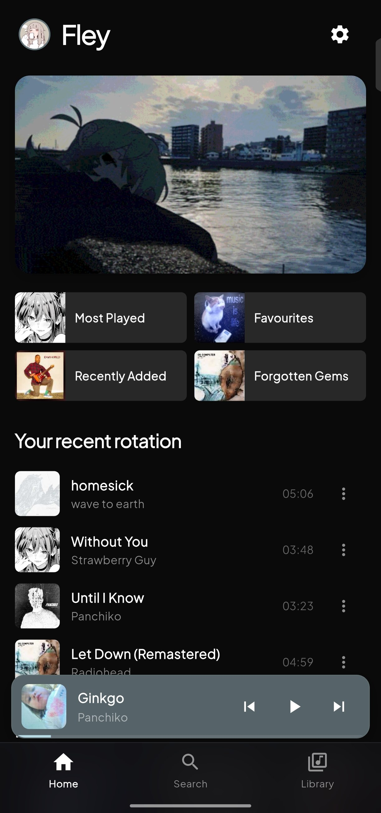
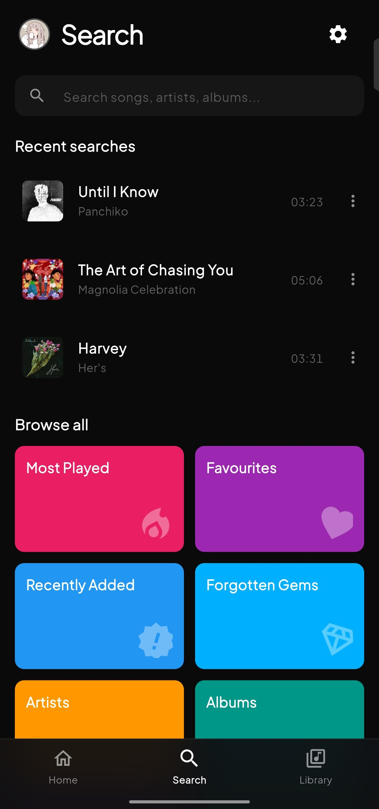
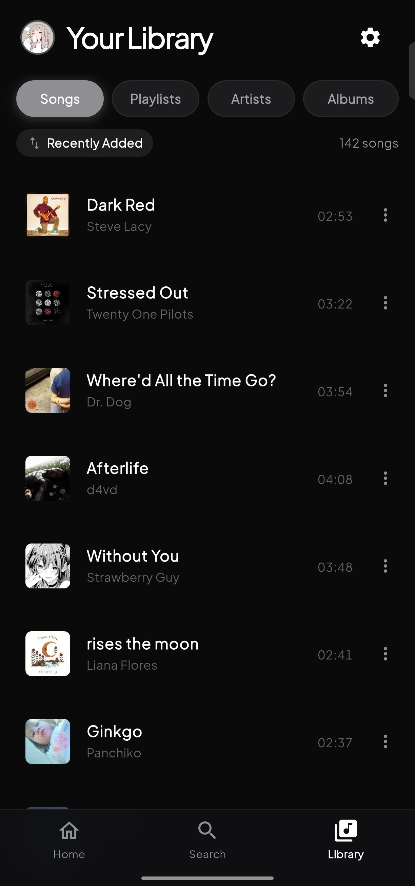
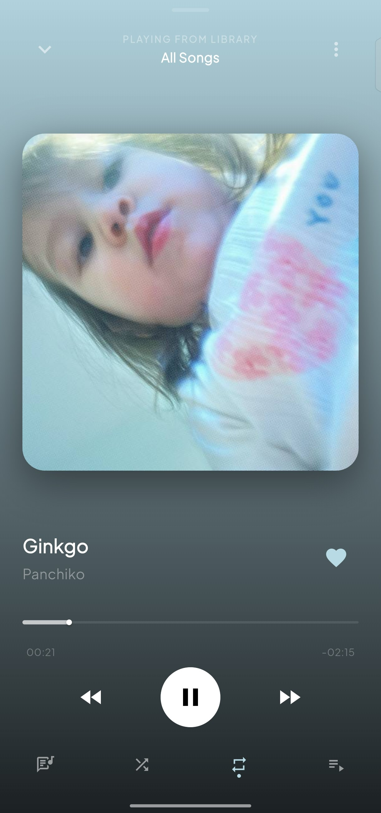
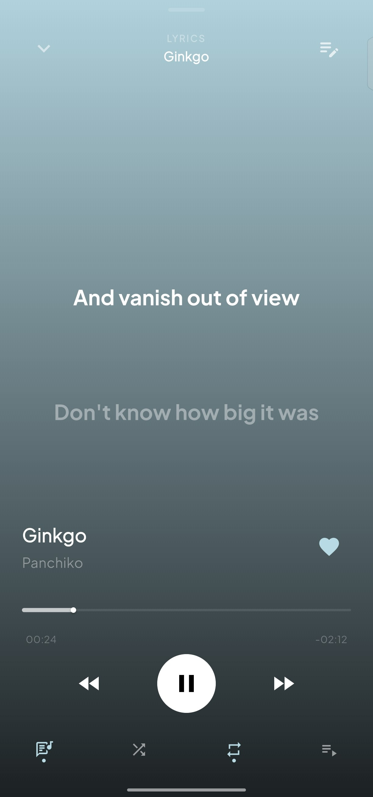
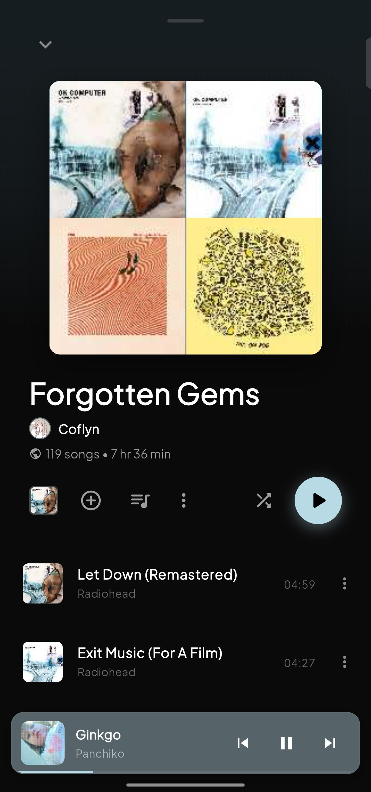

# Fley


Fley is a clean, modern offline music player for Android built with Flutter. Designed for aesthetics, fluid performance, and an uninterrupted listening experience.

## Previews

<p align="center">
  
  
  
</p>
<p align="center">
  
  
  
</p>

## Features

### Modern Navigation & Discoverability
- **Intuitive 3-Tab Experience**: Smooth navigation between **Home**, **Search**, and **Your Library** with persistent header and frosted-glass blur bottom navigation bar.
- **Dynamic Home Tab**:
  - *Quick Pins Grid*: Rapid 1-tap access to your top playlists (*Most Played*, *Favourites*, *Recently Added*, *Forgotten Gems*).
  - *Your Recent Rotation*: Quick 4-track local rotation with direct playback and options menu.
  - *Recents Carousel*: Horizontal card carousel showcasing recently played playlists and albums.
  - *Jump Back In*: Highlighted top artists with circular avatars.
- **Dedicated Search Tab**: Instant multi-field local search with discovery category tiles (*Most Played*, *Favourites*, *Recently Added*, *Artists*).
- **Your Library Tab**: Complete organization across *Songs*, *Playlists*, *Artists*, and *Albums* with quick filter capsules and dedicated sorting modal (*Recently Added*, *Title*, *Artist*, *Album*, *Duration*, *Oldest Added*).

### User Profile & Personalization
- **Dedicated Profile Screen**: Set custom profile picture with built-in square cropper (`1:1`), customizable display name, and bio.
- **Live Library Statistics**: Real-time counter card displaying total songs, custom playlists, and favorites.
- **Dynamic Author Credits**: Author row in playlist and album detail views reflecting the user's custom profile avatar, display name, and track duration.

### Audio Engine & Playback
- **High-Fidelity Offline Playback**: Supports MP3, FLAC, WAV, AAC, M4A, and OGG formats.
- **Background Playback & Lock Screen Controls**: Seamless OS-level background playback via Android MediaSession with lock screen notifications and swipe-to-dismiss task cleanup.
- **Floating Mini Player**: Elevated above the bottom navigation bar with safe padding adapting to Android navigation bars.
- **Audio Transitions**: Customizable crossfade (0ms – 3000ms) with soft volume fade-in and fade-out.
- **Tempo & Pitch Control**: Smooth playback speed adjustment (0.5x – 2.0x) with optional Pitch Lock.
- **Headset & Bluetooth Integration**: Auto-play when headphones or Bluetooth audio devices connect, and auto-pause on disconnect.
- **Equalizer Access**: Direct shortcut integration to system equalizer presets and sound effects.

### Synced Lyrics Engine
- **Synchronized LRC & Embedded Lyrics**: Real-time synced line highlighting with smooth auto-scroll to the active line.
- **Instrumental Detection**: Automatic melody indicator (3-dot wave) during instrumental intros, solos, and outros.
- **Manual Timing Offset**: Fine-tune lyric timing per-track (±0.1s / ±0.5s) directly from the player.
- **Interactive Tap-to-Seek**: Tap any lyric line to jump playback directly to that timestamp.
- **Customization Options**: Configurable auto-follow mode and past-line dimming toggles.

### Adaptive Theming & Visuals
- **Dynamic Palette Extraction**: Real-time color matching extracted from the currently playing album artwork.
- **4 Player Background Modes**: Dynamic Gradient, Apple-style Blurred Cover (with adjustable blur & dimming sliders), AMOLED Deep Black, and Custom Gallery Wallpaper.
- **System Theme Modes**: Full support for Dark, Light, and Custom Theme modes.
- **Accent Customization**: 9 curated color presets or dynamic artwork-matching accent colors.
- **Custom Typography**: Preloaded Google Fonts (Figtree, Inter, Plus Jakarta Sans) to eliminate font-flash on launch.
- **Mini Equalizer Visualizer**: Animated equalizer visualizer bars on currently playing songs.

### Library & Smart Management
- **Fast Media Scanning**: Scoped storage scanning with path deduplication and duration filters to ignore short audio clips, ringtones, and voice notes.
- **Modern Artists & Albums Views**: Grid and List layout switcher with Top Artists and Top Albums horizontal highlight carousels.
- **Virtual Metadata Editor**: Edit song titles, artists, and album tags without modifying or corrupting the original audio file.
- **Custom Artwork**: Set custom artwork from your device gallery with built-in 1:1 and 9:16 aspect ratio croppers.
- **Track Visibility**: Hide and unhide unwanted audio files from your music library.
- **Smart Sorting**: Instant sorting across titles, artists, albums, date added, and durations.

### Smart & Custom Playlists
- **Dynamic Smart Playlists**: Automatically generated *Favourites*, *Recently Added*, *Last Played*, *Most Played*, and *Forgotten Gems* based on real play statistics.
- **Custom Playlists**: Create, rename, and manage custom playlists with personalized playlist cover images.
- **Multi-Select Batch Actions**: Intuitive hold-to-select mode across all song lists for rapid queueing or mass additions.
- **Modern Action Row**: Quick-access favorite toggles, queue button, overflow options, shuffle toggle with indicator, and play button in playlist & album views.

### Utilities
- **Built-in Ringtone Cutter**: Dual-handle slider waveform editor with real-time preview and 1-tap save to `/Ringtones/`.
- **Dynamic Sleep Timer**: Set auto-stop timers (15m, 30m, 60m, or custom duration) with gentle volume fade-out.
- **Backup & Restore**: Fail-safe backup and restore of playlists, favorites, play statistics, and user settings across Android 10–15 scoped storage.
- **Internationalization (i18n)**: Fully translated into English, Indonesian, and Japanese with automatic system locale detection.

## Downloads

Download the latest release APKs directly from the [Releases](https://github.com/coflyn/Fley/releases) page:

- `fley-arm64-v8a-release.apk` (Recommended for modern 64-bit devices)
- `fley-armeabi-v7a-release.apk` (32-bit devices)
- `fley-x86_64-release.apk` (Emulators)

## Building from Source

### Prerequisites
- [Flutter SDK](https://flutter.dev/docs/get-started/install) (3.24+)
- Android SDK (`minSdk` 21, `targetSdk` 34+)
- Java Development Kit (JDK 17)

### Build Commands

```bash
# Clone the repository
git clone https://github.com/coflyn/Fley.git
cd Fley

# Fetch dependencies
flutter pub get

# Compile split release APKs
flutter build apk --release --split-per-abi
```

Compiled APK files will be located in `build/app/outputs/flutter-apk/`.

## Contributing

Contributions, bug reports, and suggestions are welcome! Please check out [CONTRIBUTING.md](CONTRIBUTING.md) for details on code style, branch guidelines, and pull requests.

## License

This project is licensed under the GNU General Public License v3.0. See the [LICENSE](LICENSE) file for more information.
